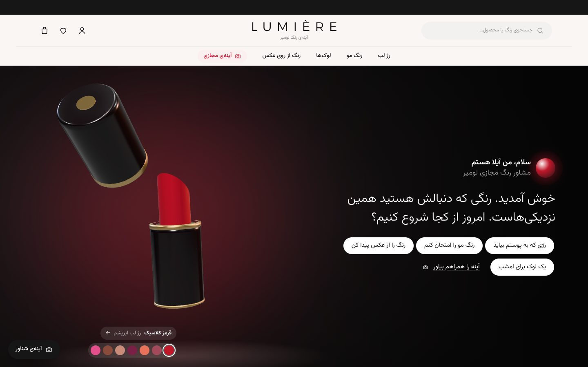
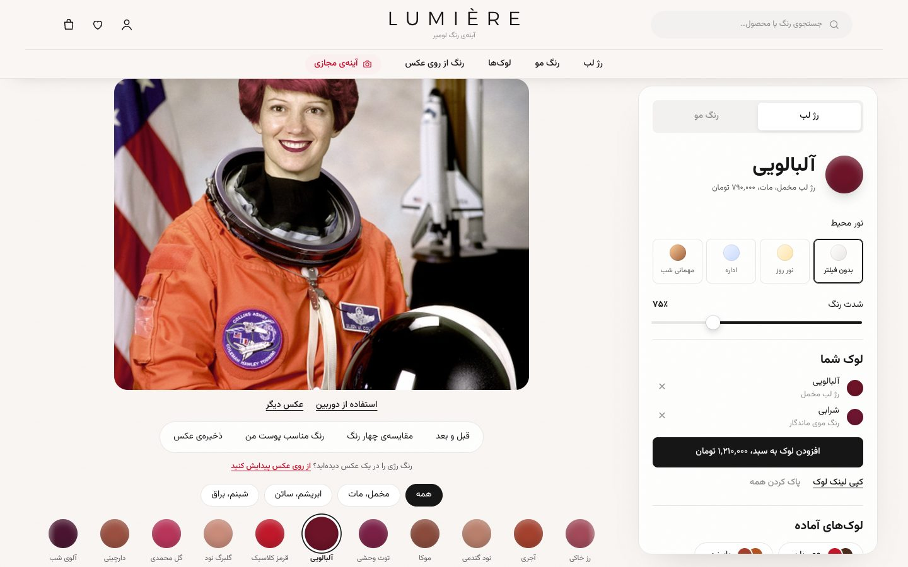
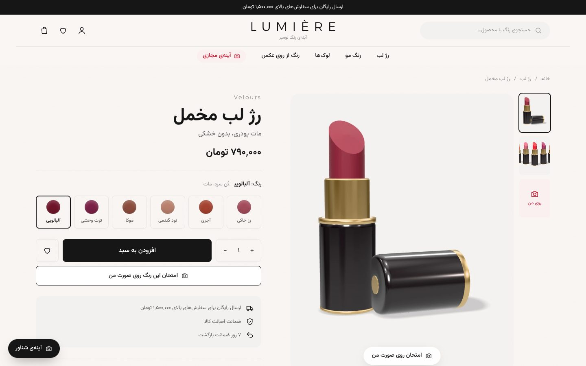
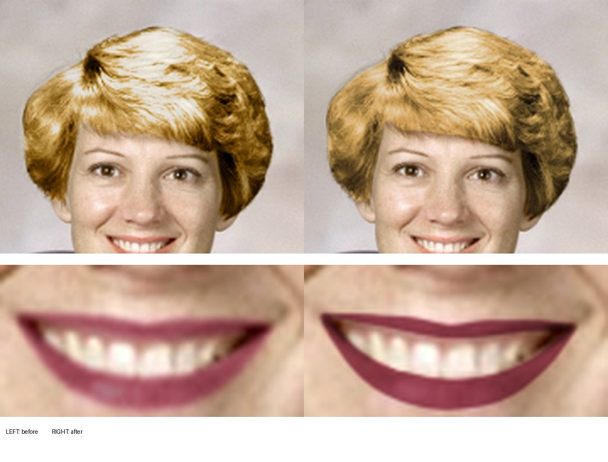
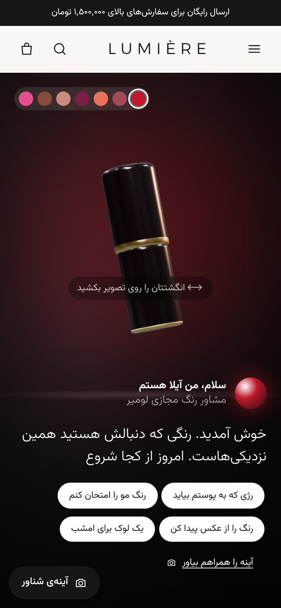
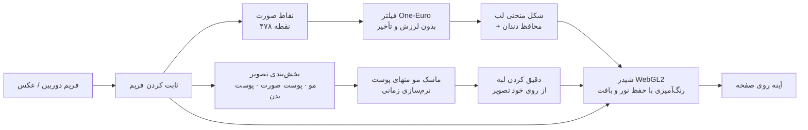

<div dir="rtl">

# لومیر (LUMIÈRE)

[](https://github.com/Behniasaberi/lumiere/actions/workflows/ci.yml)


فروشگاه فارسی لوازم آرایشی که مشتری قبل از خرید، رژ لب و رنگ مو را روی صورت خودش امتحان می‌کند؛ با دوربین زنده یا یک عکس. همه‌ی پردازش داخل مرورگر و روی دستگاه خود مشتری انجام می‌شود و هیچ تصویری به سرور نمی‌رود.

**دموی زنده:** <https://lumiere-edn8.onrender.com>. با گوشی یا لپ‌تاپ باز کنید و به دوربین اجازه بدهید، یا یک عکس انتخاب کنید.

[English](README.md)


## امکانات

### آینه‌ی مجازی
- رژ لب از روی ۴۷۸ نقطه‌ی صورت، با سه بافت مات، ساتن و براق.
- رنگ مو از روی تشخیص پیکسل‌به‌پیکسل مو.
- با دوربین زنده یا عکس.
- عوض شدن نرم رنگ‌ها، بدون پرش.
- اسلایدر قبل و بعد و مقایسه‌ی چهار رنگ کنار هم.
- ذخیره‌ی عکس با لوگو.
- نور محیط: روز، اداره و مهمانی شب.

### پیدا کردن رنگ مناسب
- **رنگ از روی عکس:** عکس هر رژی را بدهید تا سه رنگ نزدیک کاتالوگ پیدا شود (فاصله‌ی رنگ CIE Lab).
- **رنگ مناسب پوست:** پیشنهاد رژ و رنگ مو بر اساس زیرتُن و عمق رنگ پوست.
- **لوک‌های آماده:** رژ و رنگ مو با هم، با یک کلیک.

### آینه‌ی شناور
- آینه در گوشه‌ی صفحه می‌ماند و در کل فروشگاه همراه مشتری است.
- با بردن نشانگر روی هر کارت محصول، رنگ آن زنده روی صورت می‌نشیند.

### فروشگاه
- هیروی سه‌بعدی (three.js) که با ماوس یا انگشت چرخانده می‌شود، همراه مشاور رنگ مجازی «آیلا».
- فیلتر بافت و تُن، صفحه‌ی محصول با امتحان در همان صفحه.
- سبد کشویی با نوار ارسال رایگان، علاقه‌مندی‌ها، جستجو و منوی بزرگ.
- واکنش‌گرا تا عرض ۳۶۰ پیکسل.
- رعایت تنظیم «کاهش حرکت» سیستم‌عامل.

## تصاویر

| صفحه‌ی اصلی | پرفروش‌ها |
|---|---|
|  |  |
| **آینه‌ی مجازی** | **صفحه‌ی محصول** |
|  |  |





## تکنولوژی‌ها

- **رابط کاربری:** React 18، TypeScript، Vite، React Router، Tailwind CSS
- **سه‌بعدی:** three.js با مدل‌های رژ و مو که با کد ساخته شده‌اند
- **امتحان رنگ:** MediaPipe Tasks Vision (همان مدل‌های نسخه‌ی پایتون)
- **رندر:** شیدر WebGL2 روی کارت گرافیک، با مسیر جایگزین Canvas 2D
- **فونت:** وزیرمتن و Alexandria، داخل خود پروژه
- **CI و استقرار:** GitHub Actions و Render

## مسیر پردازش آینه



- **یک فریم، یک نتیجه:** مدل‌ها و رسم روی همان فریم ثابت‌شده کار می‌کنند، پس رنگ هنگام حرکت سر عقب نمی‌ماند. مدل‌ها فقط وقتی دوربین فریم تازه بدهد اجرا می‌شوند.
- **رنگ دقیق:** نور و سایه‌ی هر پیکسل حفظ می‌شود ولی میانگین رنگ دقیقاً کد رنگ محصول می‌شود. برجستگی‌ها نمی‌سوزند.
- **لب طبیعی:** براقی ساتن و براق از نور واقعی خود لب ساخته می‌شود، رژ مات مات می‌ماند و رنگ روی دندان نمی‌نشیند.

*چرا پایتون یا سی‌شارپ روی سرور نه؟* فرستادن تصویر دوربین به سرور به هر فریم تأخیر شبکه اضافه می‌کند. برای هر کاربر هم GPU سرور لازم می‌شود و تصویر صورت از دستگاه کاربر خارج می‌شود. همین مدل‌ها روی دستگاه خود کاربر با سرعت دوربین اجرا می‌شوند.

## اجرا

پیش‌نیاز: [Node.js](https://nodejs.org) نسخه‌ی ۱۸ یا بالاتر.

```bash
git clone https://github.com/Behniasaberi/lumiere.git
cd lumiere
npm install
npm run dev
```

سپس <http://localhost:5173> را باز کنید. دوربین فقط روی `localhost` یا `https` کار می‌کند.

`npm install` موتور MediaPipe را در `public/mediapipe` کپی می‌کند و دو فایل مدل را در `public/models` می‌گذارد؛ اگر پوشه‌ی `../models` کنار پروژه باشد از آنجا، وگرنه از سرور گوگل دانلود می‌کند.

| دستور | کار |
|---|---|
| `npm run dev` | سرور توسعه |
| `npm run build` | بررسی تایپ و ساخت نسخه‌ی نهایی در `dist/` |
| `npm run preview` | اجرای نسخه‌ی نهایی |
| `npm run setup:assets` | کپی دوباره‌ی موتور و مدل‌ها |

## تنظیمات

| کجا | چه چیزی |
|---|---|
| `src/data/catalog.ts` | محصولات، رنگ‌ها (کد رنگ و تُن)، قیمت‌ها، لوک‌ها، حد ارسال رایگان |
| `src/styles/global.css` | توکن‌های طراحی: رنگ، فونت، فاصله‌ها |
| `public/products/<شناسه‌ی رنگ>.webp` | عکس محصولات (فعلاً رندر سه‌بعدی؛ عکس واقعی را با همان نام جایگزین کنید) |
| `render.yaml` | تنظیمات Render: دستور ساخت، مسیرها، کش |

## بررسی‌ها

```bash
npm run typecheck
npm run build
```

GitHub Actions با هر push هر دو را اجرا می‌کند و بررسی می‌کند موتور و هر دو مدل در خروجی باشند.

## ساختار پروژه

```
src/
  engine/
    TryOnEngine.ts     دوربین/عکس، مدل‌ها، همگام‌سازی فریم، نرم‌سازی، مقایسه، پوست، ذخیره‌ی عکس
    glCompositor.ts    رنگ‌آمیزی مو و لب روی کارت گرافیک (WebGL2)
    color.ts           تبدیل رنگ و فاصله‌ی رنگ (CIE Lab)
  components/          AilaHero، TryOnStage، FloatingMirror، ShadeFinder، ShadeMarquee، ProductCard، Layout، Icons
  three/               صحنه‌ی هیرو و مدل‌های سه‌بعدی رژ و مو
  pages/               Home، Shop، Product، Studio، Looks
  data/catalog.ts      کاتالوگ و پیدا کردن رنگ نزدیک
  store/Store.tsx      لوک فعلی، سبد، علاقه‌مندی‌ها (localStorage)
  styles/              global.css و tailwind.css
scripts/setup-assets.mjs   کپی موتور و مدل‌ها در public
docs/                      تصاویر README
```

همه‌ی رنگ‌آمیزی از `TryOnEngine` رد می‌شود؛ صفحه‌ها فقط رنگ را انتخاب می‌کنند و موتور آن را در همه‌ی آینه‌های باز رسم می‌کند.

## قدم‌های بعدی

- بک‌اند (ASP.NET Core) برای کاتالوگ، سبد، سفارش و درگاه پرداخت
- رندر سمت سرور صفحه‌ها برای سئو
- عکس واقعی محصولات

</div>
