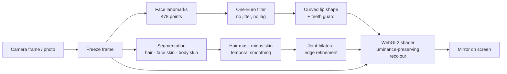

# LUMIÈRE

[](https://github.com/Behniasaberi/lumiere/actions/workflows/ci.yml)


A Persian (RTL) cosmetics store where shoppers try lipstick and hair colour on their own face before buying. They can use the live camera or a photo. Every frame is processed in the browser, on the shopper's device, and no image is ever uploaded.

**Live demo:** <https://lumiere-edn8.onrender.com>. Open it on a phone or laptop and allow the camera, or pick a photo.

[نسخه‌ی فارسی](README.fa.md)


## Features

### Virtual mirror
- Lipstick from 478 face landmarks, in matte, satin and gloss finishes.
- Hair colour from per-pixel hair segmentation.
- Works on the live camera or a still photo.
- Shade changes fade smoothly instead of jumping.
- Before/after split slider and four shades side by side.
- Saved photo with a wordmark.
- Lighting presets: daylight, office and evening.

### Finding the right shade
- **Shade from a photo:** upload any lipstick look and get the three closest shades in the catalogue, matched by CIE Lab ΔE.
- **Skin tone:** lipstick and hair suggestions from the shopper's undertone and depth.
- **Ready-made looks:** a lipstick and a hair colour applied together in one click.

### Floating mirror
- The mirror docks in a corner and follows the shopper through the whole store.
- Hovering a product card applies its shade live.

### Store
- 3D hero (three.js) that the shopper scrubs with the mouse or a finger, guided by a virtual colour advisor with suggestion chips.
- Shop pages with finish and undertone filters, plus product pages with in-page try-on.
- Cart drawer with a free-shipping meter, wishlist, search and mega menu.
- Responsive down to 360 px.
- Respects `prefers-reduced-motion`.

## Screenshots

| Home | Bestsellers |
|---|---|
|  |  |
| **Virtual mirror** | **Product page** |
|  |  |


## Tech stack

- **UI:** React 18, TypeScript, Vite, React Router, Tailwind CSS
- **3D:** three.js, with procedural lipstick and hair models
- **Try-on:** MediaPipe Tasks Vision (`face_landmarker`, `selfie_multiclass_256x256`), the same models as the Python package
- **Rendering:** a WebGL2 fragment shader, with a Canvas 2D fallback
- **Fonts:** Vazirmatn and Alexandria, self-hosted
- **CI and deployment:** GitHub Actions and Render (static site)

## Try-on pipeline



- **Same frame in, same frame out.** The models and the drawing use one frozen frame, so the colour never lags behind a moving head. The models run only when the camera delivers a new frame.
- **True-to-shade colour.** Each pixel keeps its own light and shade, but the average lands exactly on the product's hex colour. Highlights roll off softly instead of turning white.
- **Natural lips.** Satin and gloss shine comes from the lips' real highlights, and matte stays matte. The teeth are never coloured.

*Why not Python or C# on a server?* Sending video to a server adds network latency to every frame. It also needs a GPU per shopper and moves face images off the device. The same models run locally at camera frame rate.

## Getting started

Prerequisite: [Node.js](https://nodejs.org) 18 or newer.

```bash
git clone https://github.com/Behniasaberi/lumiere.git
cd lumiere
npm install
npm run dev
```

Open <http://localhost:5173>. The camera only works on `localhost` or `https`.

`npm install` also runs `scripts/setup-assets.mjs`. It copies the MediaPipe wasm into `public/mediapipe` and fetches the two model files into `public/models`. If a sibling `../models` folder exists, it copies them from there; otherwise it downloads them from Google's model storage.

| Command | What it does |
|---|---|
| `npm run dev` | dev server with hot reload |
| `npm run build` | type check + production build into `dist/` |
| `npm run preview` | serve the production build locally |
| `npm run setup:assets` | re-copy the wasm and models |

## Configuration

| Where | What |
|---|---|
| `src/data/catalog.ts` | products, shades (hex colour, undertone), prices, ready-made looks, free-shipping threshold |
| `src/styles/global.css` | design tokens: colours, fonts, spacing |
| `public/products/<shade-id>.webp` | product photos (3D renders for now; drop in real photos with the same names) |
| `render.yaml` | Render static site: build command, SPA rewrite, cache headers |

## Checks

```bash
npm run typecheck
npm run build
```

GitHub Actions runs both on every push and pull request. It also verifies that the MediaPipe wasm and both model files end up in the build.

## Project structure

```
src/
  engine/
    TryOnEngine.ts     camera/photo, models, frame sync, smoothing, compare, skin tone, snapshot
    glCompositor.ts    GPU recolouring of hair and lips (WebGL2)
    color.ts           colour conversions and ΔE (CIE Lab)
  components/          AilaHero, TryOnStage, FloatingMirror, ShadeFinder, ShadeMarquee, ProductCard, Layout, Icons
  three/               hero scene and procedural lipstick / hair models
  pages/               Home, Shop, Product, Studio, Looks
  data/catalog.ts      catalogue and shade matching
  store/Store.tsx      current look, cart, wishlist (localStorage)
  styles/              global.css and tailwind.css
scripts/setup-assets.mjs   copies wasm and models into public/
docs/                      README images
```

All try-on drawing goes through `TryOnEngine`. Pages only pick a shade, and the engine renders it into every mounted mirror.

## Roadmap

- Backend (ASP.NET Core) for catalogue, cart, orders and payment
- Server-side rendering of store pages for SEO
- Real product photography
